# System Architecture & Technical Design Specification

> **System:** AI Evaluation, RAG Triad, & Observability Platform  
> **Target Audience:** System Architects, Lead Engineers, and Infrastructure Specialists.

---

## 📌 Table of Contents
1. [Executive Architectural Overview](#1-executive-architectural-overview)
2. [The Elephant-Goldfish Model (EGM) Architecture](#2-the-elephant-goldfish-model-egm-architecture)
3. [Subsystem 1: Document Ingestion & Vector Storage (pgvector)](#3-subsystem-1-document-ingestion--vector-storage-pgvector)
4. [Subsystem 2: Retrieval & Generation Orchestrator](#4-subsystem-2-retrieval--generation-orchestrator)
5. [Subsystem 3: Stateless Bounded Evaluator (The Goldfish)](#5-subsystem-3-stateless-bounded-evaluator-the-goldfish)
6. [Subsystem 4: React 19 Universal UI V2 Console](#6-subsystem-4-react-19-universal-ui-v2-console)
7. [Subsystem 5: Telemetry, Observability & Metrics](#7-subsystem-5-telemetry-observability--metrics)
8. [Agentic Extension: Model Context Protocol (MCP) Tools](#8-agentic-extension-model-context-protocol-mcp-tools)
9. [End-to-End System Sequence Diagram](#9-end-to-end-system-sequence-diagram)

---

## 1. Executive Architectural Overview

The platform is designed around strict separation between **persistent state retention**, **stateless evaluation auditing**, **interactive visualization**, and **continuous telemetry**:

```
┌─────────────────────────────────────────────────────────────────────────────────────────────┐
│                                CLIENT WORKSPACE LAYER                                       │
│                                                                                             │
│                      Universal UI V2 Evaluation Console (React 19)                          │
│          ┌───────────────────────┬─────────────────────────┬──────────────────────┐         │
│          │ Panel 1: Nav Rail     │ Panel 2: Explorer       │ Panel 3: Inspector   │         │
│          │ (56px - 320px)        │ (360px - 364px)         │ (Min 480px Floor)    │         │
│          └───────────────────────┴─────────────────────────┴──────────────────────┘         │
│                     Enforced 900px Desktop Viewport Gate (No horizontal breaks)             │
└──────────────────────────────────────────────┬──────────────────────────────────────────────┘
                                               │ HTTP / REST / WebSocket
                                               ▼
┌─────────────────────────────────────────────────────────────────────────────────────────────┐
│                              BACKEND ORCHESTRATION LAYER                                    │
│                                                                                             │
│                         FastAPI Application Server (Python 3.10+)                           │
│     ┌─────────────────────┬───────────────────────────┬───────────────────────────────┐     │
│     │ Ingestion & Chunking│ RAG Generation Pipeline   │ Background Async Evaluation   │     │
│     │ (pypdf, embeddings) │ (GPT-6, GPT-5.5, GPT-4o)  │ Worker (Celery/asyncio tasks) │     │
│     └─────────────────────┴───────────────────────────┴───────────────────────────────┘     │
└──────────────────────┬───────────────────────┬───────────────────────────────┬──────────────┘
                       │                       │                               │
                       ▼                       ▼                               ▼
┌───────────────────────────────┐ ┌─────────────────────────────┐ ┌───────────────────────────┐
│     THE ELEPHANT (Storage)    │ │    THE GOLDFISH (Auditing)  │ │   TELEMETRY & MONITORING  │
│                               │ │                             │ │                           │
│  PostgreSQL 16 (Port 5434)    │ │  Stateless LLM Evaluator    │ │  Prometheus (Port 9090)   │
│  • pgvector HNSW Cosine Index │ │  • gpt-6-astra / gpt-4o     │ │  • Scrapes /metrics       │
│  • document_embeddings        │ │  • Zero external memory     │ │  Grafana 11.1 (Port 3000) │
│  • rag_evaluations            │ │  • Atomic claim extraction  │ │  • Dashboards & Alerts    │
│  • eval_sessions / turns      │ │  • RAG Triad scoring        │ │  Rotating system.log      │
└───────────────────────────────┘ └─────────────────────────────┘ └───────────────────────────┘
```

---

## 2. The Elephant-Goldfish Model (EGM) Architecture

### Design Philosophy
Traditional evaluation pipelines often suffer from two major problems:
* **Memory Bleed:** An evaluator model uses its own internal pre-trained memory to validate an answer, accepting claims that are true in the real world but completely absent from the retrieved documents.
* **Audit Blindspots:** Evaluation scores are stored in memory or disconnected logs, making it impossible to reconstruct what the model actually read when it answered.

The **Elephant-Goldfish Model (EGM)** divides responsibilities cleanly:

### 1. The Elephant (Long-Term Memory & Traceability)
* Stored in **PostgreSQL 16** with the **pgvector** extension on port `5434`.
* Never forgets: Every document chunk, vector embedding, user query, retrieved excerpt set, model output, and evaluation verdict is permanently recorded.
* Enables full audit replay: Any evaluation score can be inspected months later with exact chunk attribution.

### 2. The Goldfish (Stateless, Unbiased Audit Engine)
* Operates in an isolated, memory-less context with **zero conversational baggage**.
* The prompt specifically strips all world-knowledge assumptions:
  ```
  THE GOLDFISH PRINCIPLE: Evaluate with ZERO external knowledge.
  If a claim is true in the real world but NOT in the provided context,
  it is UNSUPPORTED.
  ```
* Evaluates only the discrete bundle: `(User Query, Retrieved Context Chunks, Generated Answer)`.

---

## 3. Subsystem 1: Document Ingestion & Vector Storage (pgvector)

The knowledge base subsystem ingests unstructured enterprise documentation into searchable vector space.

### Ingestion Pipeline
1. **Document Loading:** Raw files (`.pdf`, `.txt`, `.md`) are read via `pypdf` or native text loaders.
2. **Chunking Engine:** Splits documents into overlapping segments (default: 800 characters with 100-character overlap) to prevent losing context across chunk boundaries.
3. **Embedding Computation:** Calls OpenAI `text-embedding-3-small`, transforming each chunk into a 1536-dimensional dense float vector.
4. **Relational Storage:** Chunks and embeddings are stored in PostgreSQL:
   ```sql
   CREATE TABLE document_embeddings (
       id SERIAL PRIMARY KEY,
       document_name VARCHAR(255) NOT NULL,
       chunk_index INT NOT NULL,
       chunk_text TEXT NOT NULL,
       embedding vector(1536) NOT NULL,
       metadata JSONB DEFAULT '{}'::jsonb,
       created_at TIMESTAMP WITH TIME ZONE DEFAULT NOW()
   );
   ```
5. **HNSW Vector Indexing:** Employs Hierarchical Navigable Small World (HNSW) indexing using cosine distance operators (`vector_cosine_ops`) for sub-millisecond approximate nearest neighbor retrieval:
   ```sql
   CREATE INDEX idx_doc_embedding_hnsw 
   ON document_embeddings USING hnsw (embedding vector_cosine_ops);
   ```

---

## 4. Subsystem 2: Retrieval & Generation Orchestrator

Located in `src/server.py` and `src/generator.py`:
* **Query Embedding:** Converts the incoming query into a 1536-dim vector.
* **Similarity Search:** Queries `document_embeddings` using cosine distance (`<=>`), retrieving the top-$k$ nearest chunks.
* **Target Document Filter:** Evaluates target aliases (`detect_target_documents`) to narrow search scope when a query references a specific manual or policy.
* **Grounded Generation:** Formats retrieved chunks into a structured prompt with strict grounding constraints.
* **Frontier Model Dispatch:** Dispatches to the chosen model (`gpt-6-astra`, `gpt-6.1-sol`, `gpt-5.5`, `gpt-4o`, `gpt-4o-mini`) with high reasoning effort where supported.

---

## 5. Subsystem 3: Stateless Bounded Evaluator (The Goldfish)

Located in `src/evaluator.py`:
The evaluation engine runs as an asynchronous background worker using OpenAI structured outputs (`pydantic` response formats):

### Triad Evaluation Schema
```python
class ClaimAnalysis(BaseModel):
    claim: str
    is_supported: bool
    evidence_chunk_index: Optional[int]
    reasoning: str

class TriadEvaluationOutput(BaseModel):
    claims: List[ClaimAnalysis]
    context_relevance_score: float
    context_relevance_explanation: str
    answer_relevance_score: float
    answer_relevance_explanation: str
    overall_summary: str
```

### Mathematical Scoring Formulas
1. **Faithfulness Score ($F$):**
   $$F = \frac{\text{Count of Supported Claims}}{\text{Total Claims Extracted}}$$
2. **Composite Confidence Score ($C$):**
   $$C = (0.50 \times F) + (0.30 \times AR) + (0.20 \times CR)$$
   *Where $AR$ = Answer Relevancy ($0.0 - 1.0$), and $CR$ = Context Relevance ($0.0 - 1.0$).*

---

## 6. Subsystem 4: React 19 Universal UI V2 Console

The frontend strictly implements the Universal UI Guide V2 standards:

### Geometry & Layout Specifications
* **Panel 1 (Navigation Rail):** 56px collapsed width; expandable from 180px to 320px via drag handle.
* **Panel 2 (Session Explorer):** 360px–364px retained column with independent vertical scrollbar.
* **Panel 3 (Task & Detail Inspector):** Minimum 480px width floor; automatically expands to fill available viewport space.
* **Splitters:** Border-overlay drag splitters adding zero structural layout width.
* **Viewport Floor:** SupportedViewportGate component blocks viewports `< 900px` without horizontal scrolling or clipped cards.

### State Continuity
* Active session selections, filter states, scroll bookmarks, and expanded inspector tabs are preserved in memory during theme toggles or window resizing.
* Data export actions (Clipboard, XLSX, PDF) project the exact visible columns, labels, and values rendered on the screen.

---

## 7. Subsystem 5: Telemetry, Observability & Metrics

Located in `src/metrics.py` and `hello-mcp/prometheus.yml`:
* **Prometheus Client:** Exposes live metrics on `/metrics`:
  * `rag_eval_queries_total`: Total queries counter labeled by `model_id` and `verdict`.
  * `rag_eval_confidence_score`: Histogram of confidence distributions ($[0.1 .. 1.0]$).
  * `rag_eval_faithfulness_ratio`: Gauge of current groundedness trends.
  * `rag_eval_latency_seconds`: End-to-end latency histograms.
* **Database Synchronization:** `sync_metrics_from_db()` reconciles historical evaluation scores from PostgreSQL into Prometheus upon backend startup.
* **Grafana Dashboards:** Pre-provisioned dashboards on port `3000` visualize latency p95/p99, hallucination alerts, token expenditure, and model win/loss ratios.

---

## 8. Agentic Extension: Model Context Protocol (MCP) Tools

The platform includes an agentic arithmetic subsystem via the **Model Context Protocol (MCP)**:
* Isolated micro-servers running over standard I/O (stdio) via `FastMCP` (`server_add.py`, `server_sub.py`, `server_mul.py`, `server_div.py`).
* Replaces next-token heuristic arithmetic with deterministic external tool execution.
* Protects against floating-point overflow (>15 digits), division by zero, and invalid IEEE-754 floats.

---

## 9. End-to-End System Sequence Diagram

```mermaid
sequenceDiagram
    autonumber
    actor User as User / Frontend UI
    participant Web as Universal UI V2 Console
    participant API as FastAPI Backend (src/api.py)
    participant DB as PostgreSQL (pgvector)
    participant Gen as Generator LLM (GPT-6 / GPT-4o)
    participant Judge as Goldfish Evaluator
    participant Prom as Prometheus / Grafana

    User->>Web: Submit Query + Select Model
    Web->>API: POST /api/query { query, model_id, top_k }
    
    rect rgb(30, 41, 59)
    note over API,DB: Cosine Vector Retrieval
    API->>API: Generate 1536-dim Embedding
    API->>DB: HNSW Cosine Search (embedding <=> query_vec)
    DB-->>API: Top-k Context Chunks & Metadata
    end

    rect rgb(15, 23, 42)
    note over API,Gen: Strictly Grounded Synthesis
    API->>Gen: Prompt + Grounding Rules + Chunks
    Gen-->>API: Grounded Answer + Latency
    end

    API-->>Web: Stream Answer & Chunks to User
    Web-->>User: Visual Render in Panel 3 Inspector

    par Async Background Audit
        API->>Judge: evaluate_rag_triad(query, chunks, answer)
        Judge->>Judge: Atomic Claim Decomposition
        Judge->>Judge: Groundedness Check (is_supported)
        Judge-->>API: Output (Claims, Scores, Confidence, Verdict)
        API->>DB: INSERT INTO rag_evaluations
        API->>Prom: Update Evaluation Metrics & Histograms
        API-->>Web: Push Audit Completion (WebSocket / Polling)
        Web-->>User: Render RAG Triad Score Cards & Hallucination Flags
    end
```


