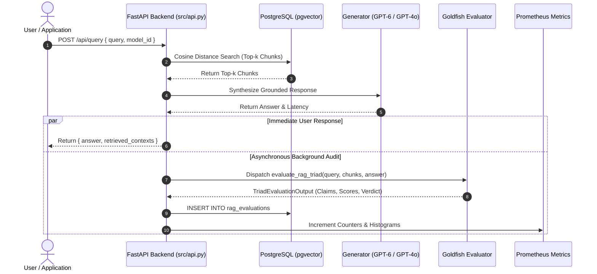

# RAG Triad & Hallucination Analysis Guide

> **Architecture:** The Elephant-Goldfish Model (EGM)  
> **Target Audience:** AI Engineers, LLM Evaluators, Retrieval Specialists, and QA Architects.

---

## 📌 Table of Contents
1. [The Elephant-Goldfish Model (EGM) Overview](#1-the-elephant-goldfish-model-egm-overview)
2. [Document Ingestion & pgvector Pipeline](#2-document-ingestion--pgvector-pipeline)
3. [The RAG Triad Evaluation Framework](#3-the-rag-triad-evaluation-framework)
4. [Atomic Claim Decomposition & Hallucination Detection](#4-atomic-claim-decomposition--hallucination-detection)
5. [Composite Confidence Score & Verdict Rules](#5-composite-confidence-score--verdict-rules)
6. [Asynchronous Non-Blocking Evaluation Flow](#6-asynchronous-non-blocking-evaluation-flow)
7. [Mitigating RAG Failures & Hallucinations](#7-mitigating-rag-failures--hallucinations)

---

## 1. The Elephant-Goldfish Model (EGM) Overview

In production RAG systems, two common architectural pitfalls undermine reliability:
1. **Evaluator Memory Contamination (Memory Bleed):** Evaluator LLMs often rely on their own internal parametric training memory rather than auditing strictly what was retrieved. A model might approve an answer as "correct" because it is a true fact in the real world, even when the retrieved context never stated it.
2. **State Ephemerality:** Disjointed chat systems fail to maintain complete traceability from query to chunk retrieval, generation, evaluation, and telemetry.

The **Elephant-Goldfish Model (EGM)** solves this through clean architectural separation:

```
┌─────────────────────────────────────────────────────────────────────────────┐
│                       THE ELEPHANT (Never Forgets)                          │
│                                                                             │
│  • PostgreSQL 16 + pgvector (port 5434)                                     │
│  • Stores all document chunks, 1536-dim embeddings, and HNSW indexes        │
│  • Persists every query, retrieved chunk list, model output, and audit log  │
│  • Prometheus (9090) + Grafana (3000) retain long-term score distributions  │
└──────────────────────────────────────┬──────────────────────────────────────┘
                                       │
                    Dispatches isolated evaluation payload
                                       │
                                       ▼
┌─────────────────────────────────────────────────────────────────────────────┐
│                       THE GOLDFISH (Zero Memory Bleed)                      │
│                                                                             │
│  • Stateless Bounded Evaluator (`gpt-6-astra` / `gpt-4o`)                   │
│  • Zero access to external web or conversational baggage                    │
│  • Strict instruction: "If a fact is true in the real world but not in the  │
│    provided context chunks, it is UNSUPPORTED (Hallucinated)."              │
│  • Decomposes response into discrete claims and verifies against context    │
└─────────────────────────────────────────────────────────────────────────────┘
```

---

## 2. Document Ingestion & pgvector Pipeline

All knowledge documents are stored and indexed within PostgreSQL 16 using `pgvector`.

### Ingestion Flow
1. **Document Loading:** Documents (`.pdf`, `.txt`, `.md`) are read from `/rag_docs` or uploaded dynamically via the UI (`/api/upload`).
2. **Text Chunking:** Text is split into overlapping chunks (typically 500–1000 characters with 100-character overlap) to preserve semantic continuity across boundaries.
3. **Vector Embedding:** Embeddings are generated via OpenAI's `text-embedding-3-small` model, producing 1536-dimensional dense vectors.
4. **pgvector Storage:** Chunks, embeddings, and metadata are committed to the `document_embeddings` table:
   ```sql
   INSERT INTO document_embeddings 
     (document_name, chunk_index, chunk_text, embedding, metadata)
   VALUES (%s, %s, %s, %s, %s);
   ```
5. **HNSW Indexing:** Retrieval queries execute approximate nearest-neighbor cosine distance searches using the Hierarchical Navigable Small World (HNSW) index:
   ```sql
   SELECT chunk_text, document_name, chunk_index, 
          1 - (embedding <=> %s::vector) AS cosine_similarity
   FROM document_embeddings
   ORDER BY embedding <=> %s::vector
   LIMIT %s;
   ```

### Smart Document Detection
The system includes alias mapping (`detect_target_documents` in `src/db.py`) to automatically identify target documents when queries reference specific titles, authors, or concepts (e.g., matching "Darcy" to *Pride and Prejudice*, or "RPO" to *Cloud Disaster Recovery*).

---

## 3. The RAG Triad Evaluation Framework

The RAG Triad evaluates the three fundamental relationships in any retrieval-augmented generation pipeline:

```
                     ┌──────────────────┐
                     │    User Query    │
                     └────────┬─────────┘
                              │
               Context        │        Answer
              Relevance       │       Relevancy
                              │
           ┌──────────────────┴──────────────────┐
           ▼                                     ▼
┌─────────────────────┐               ┌─────────────────────┐
│  Retrieved Context  │──────────────▶│ Generated Response  │
│       Chunks        │  Faithfulness │                     │
└─────────────────────┘ (Groundedness)└─────────────────────┘
```

### 1. Faithfulness / Groundedness ($0.0 - 1.0$)
* **Definition:** Measures whether every factual claim in the generated response can be directly inferred from the retrieved context.
* **Evaluation Method:** Atomic claim decomposition. Every sentence is split into discrete factual assertions, each graded individually as `is_supported = true` or `is_supported = false`.
* **Formula:**
  $$\text{Faithfulness} = \frac{\sum \text{Supported Claims}}{\text{Total Claims}}$$

### 2. Context Relevance ($0.0 - 1.0$)
* **Definition:** Measures the signal-to-noise ratio of the retrieved context chunks relative to the user query.
* **Evaluation Method:** Evaluates whether the retrieved chunks were genuinely necessary to answer the prompt or contained redundant, extraneous text.
* **Impact:** Low context relevance indicates poor retrieval or excessive chunk sizes, which increases token cost and dilutes generator focus.

### 3. Answer Relevancy ($0.0 - 1.0$)
* **Definition:** Measures how directly, completely, and accurately the generated response addresses the user's intent.
* **Evaluation Method:** Evaluates whether the model directly answered all sub-questions without dodging, rambling, or providing incomplete summaries.

---

## 4. Atomic Claim Decomposition & Hallucination Detection

The Goldfish auditor executes strict structured claim verification:

### Example Evaluation Run
* **User Query:** *"What is the maximum allowed continuous replication lag under the DR tier-1 policy?"*
* **Retrieved Context:** *"Tier-1 critical databases require an RPO of 15 minutes and an RTO of 1 hour. Replication lag must remain below 30 seconds under normal operation."*
* **Generated AI Response:** *"Under the Tier-1 policy, replication lag must stay below 30 seconds, and the disaster recovery team conducts mandatory drills every 90 days."*

### Auditor Breakdown:
| Claim # | Atomic Claim | Evidence Chunk | Status | Auditor Reasoning |
| :--- | :--- | :--- | :--- | :--- |
| **Claim 1** | *"Under Tier-1 policy, replication lag must stay below 30 seconds"* | Chunk 1 | **SUPPORTED** | Directly stated in context chunk 1. |
| **Claim 2** | *"Disaster recovery team conducts mandatory drills every 90 days"* | None | **HALLUCINATION** | The 90-day drill requirement is not mentioned anywhere in the retrieved text. |

* **Result:** Total Claims: 2 | Supported: 1 | **Faithfulness Score: 0.50**  
* **Flag:** `HALLUCINATION_DETECTED`

---

## 5. Composite Confidence Score & Verdict Rules

To provide a single, actionable quality indicator, the system computes a weighted **Composite Confidence Score**:

$$\text{Confidence Score} = (0.50 \times \text{Faithfulness}) + (0.30 \times \text{Answer Relevancy}) + (0.20 \times \text{Context Relevance})$$

### Rationale for Weights:
* **Faithfulness (50%):** In enterprise RAG, hallucination is catastrophic. Groundedness carries the highest weight.
* **Answer Relevancy (30%):** An answer that is fully grounded but fails to answer the question is useless.
* **Context Relevance (20%):** Noise in retrieval is suboptimal but acceptable if the generator maintains high groundedness.

### Verdict Classifications
Based on the scores, the system assigns one of four standard verdicts:

```
┌─────────────────────────┬──────────────────────┬────────────────────────────────────────────────────────┐
│ Verdict                 │ Thresholds           │ Operational Action                                     │
├─────────────────────────┼──────────────────────┼────────────────────────────────────────────────────────┤
│ HIGH_CONFIDENCE         │ Confidence ≥ 85% &   │ Production Safe. Pass response to end-user.            │
│                         │ Faithfulness = 1.0   │                                                        │
├─────────────────────────┼──────────────────────┼────────────────────────────────────────────────────────┤
│ MEDIUM_CONFIDENCE       │ 70% ≤ Conf < 85% &   │ Acceptable with minor retrieval noise or partial info. │
│                         │ Faithfulness ≥ 0.85  │                                                        │
├─────────────────────────┼──────────────────────┼────────────────────────────────────────────────────────┤
│ HALLUCINATION_DETECTED  │ Faithfulness < 0.80  │ High Risk. Response contains unverified claims.        │
│                         │                      │ Flagged in audit logs and highlighted in UI.           │
├─────────────────────────┼──────────────────────┼────────────────────────────────────────────────────────┤
│ LOW_QUALITY             │ Confidence < 70%     │ Poor retrieval or evasion. Regenerate or alert admin.  │
└─────────────────────────┴──────────────────────┴────────────────────────────────────────────────────────┘
```

---

## 6. Asynchronous Non-Blocking Evaluation Flow

To deliver instant responses to users while maintaining rigorous auditing, evaluations run asynchronously:



---

## 7. Mitigating RAG Failures & Hallucinations

When hallucination alerts trigger, use the following operational remedies:

1. **Low Faithfulness (Hallucination Detected):**
   * Review generator system prompt in `src/generator.py`. Ensure instructions forbid world-knowledge extrapolations.
   * Lower generator temperature (e.g. `0.0` or `0.1`).
   * Switch generation model to `gpt-6-astra` or `gpt-5.5` for stricter grounding adherence.

2. **Low Context Relevance (High Noise):**
   * Decrease `top_k` retrieval parameter (e.g., from 8 down to 4).
   * Refine chunking size to avoid overly broad passages.
   * Verify vector index distance metric (`vector_cosine_ops`).

3. **Low Answer Relevancy:**
   * Improve query pre-processing and target document resolution.
   * Verify that the knowledge base contains the factual domain requested by the query.
